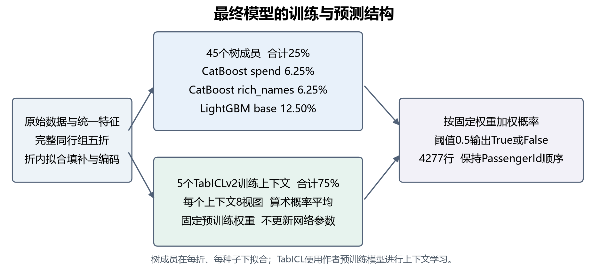
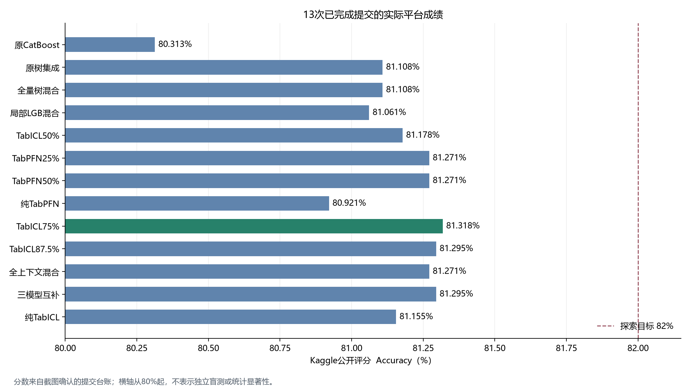

# Spaceship Titanic 乘客传送预测

使用乘客属性、舱位和消费记录预测 `Transported`。最终模型融合 **CatBoost、LightGBM与TabICLv2**，已观测的最高Kaggle公开评分为 **0.81318（81.318%）**，相比首次提交0.80313提高 **1.005个百分点**。成绩依据见[提交台账与原始截图](docs/Kaggle提交记录.md)。

项目全部源码、实验记录及[课程报告](docs/course_report/README.md)已上传至本仓库。报告包含问题简介、小组分工、实验方法和结果；模型复现方法见下文。

## 最终模型是怎样得到的



1. **数据与特征**：8693条训练记录、4277条测试记录。拆分Cabin为Deck、CabinNum、Side，构造消费与同行组特征。GroupSize、SurnameSize等无标签统计在公开train+test特征池中统一计算；填补和编码只拟合每个训练折。
2. **按组验证**：使用`features/folds.csv`的五折，保持完整GroupId隔离。训练与测试没有共享GroupId，不进行训练标签向测试组的传播。
3. **树模型训练**：开发阶段比较32组CatBoost和48组LightGBM配置，再冻结三个配置，按五折和三个种子42/2026/103训练45个成员。精确参数见[冻结配置](reports/experiments/optimization_20261025/frozen_plan.json)。
4. **TabICL上下文学习**：使用固定作者TabICLv2权重和18列精简输入，为五折分别保存训练上下文。每个上下文保留全部8个视图，并采用算术概率平均。最终方案没有更新预训练网络参数。
5. **融合与输出**：树模型合计25%，TabICL合计75%，阈值固定为0.5。按原始PassengerId顺序输出4277行布尔预测。

| 最终组件 | 构成 | 总权重 |
|---|---|---:|
| CatBoost spend/native | 555轮、depth 6；5折×3种子 | 6.25% |
| CatBoost rich_names/native | 748轮、depth 5；5折×3种子 | 6.25% |
| LightGBM base/rule_group | 327轮、15叶；5折×3种子 | 12.50% |
| TabICLv2 compact18 | 5个上下文，每个8视图、seed 42 | 75.00% |

顶层共50个成员。LightGBM的三个种子产生相同预测，不能当作三份独立多样性。TabICL的8个视图也不是8次重新预训练。

## 实际准确率与验证口径

| 方案 | 本地验证结果及口径 | Kaggle公开评分 |
|---|---|---:|
| 原CatBoost | 原统一五折均值0.8163 | 0.80313 |
| 原45成员树集成 | 原五折均值0.8157，参与过模型选择 | 0.81108 |
| 树50% + TabICL50% | 选定方案后的原五折OOF为0.821235 | 0.81178 |
| **树25% + TabICL75%** | 四套历史分组均值0.815397 | **0.81318** |

表中的本地数字使用不同的划分或选择阶段，不能直接作同口径排名。最终权重来自公开榜单反馈后的探索性选择；四套历史划分仍是同一批8693人，不能当作四份独立数据。最高公开分数也不代表未受选择影响的盲测准确率。



共13次已完成提交。提高TabICL占比、全训练上下文混合和三模型互补均未超过0.81318；更多视图、微调及其他模型方向也保留了失败记录。项目已结束本轮提分，详细研究放在[项目进度](docs/项目进度.md)、[TabICL聚合改进](docs/TabICL失稳诊断与概率平均_20261030.md)和[不同权重对照](docs/不同预训练权重对照_20261101.md)。

## 准备数据和环境

所有命令从仓库根目录执行。下载[竞赛数据](https://www.kaggle.com/competitions/spaceship-titanic/data)，将以下三个原始文件放入`data/raw/`：

```text
train.csv
test.csv
sample_submission.csv
```

最终模型使用的已验证环境为Windows、Python 3.14.6、RTX 5060 Laptop 8GB、torch 2.14.1+cu130、tabicl 2.2.0、CatBoost 1.2.10和LightGBM 4.7.0。GPU模型的固定实现需要CUDA；普通树模型及分析任务可使用`requirements.txt`。

```powershell
py -3.14 -m venv .venv-final
.\.venv-final\Scripts\python.exe -m pip install torch==2.14.1+cu130 --index-url https://download.pytorch.org/whl/cu130
.\.venv-final\Scripts\python.exe -m pip install -r requirements-final.txt
.\.venv-final\Scripts\python.exe -B -m scripts.prepare_tabicl
```

下载脚本固定作者仓库修订号、文件大小及SHA256，不上传比赛数据。检查点为`tabicl-classifier-v2-20260212.ckpt`，预期SHA256为`bdc7dbd5e4ff21f8f0456fcf90c6b7cdf72dbea960f2d05b19bec19f9b3d4ed0`。

## 按固定方案重建最终模型

`rebuild_final`直接读取原始数据、固定折映射和冻结参数，重新拟合45个树成员及5个TabICL上下文。它不需要开发期模型、预测缓存或重新执行参数搜索。

```powershell
# 先检查数据、折映射、作者权重和输出目录，不进行训练
.\.venv-final\Scripts\python.exe -B -m scripts.rebuild_final --run-name my_final --dry-run

# 按已经选定的方案重建；run-name必须是新目录名
.\.venv-final\Scripts\python.exe -B -m scripts.rebuild_final --run-name my_final --threads 4
```

产物包括：

- `models/my_final/ensemble.joblib`：可重载的最终组合。
- `outputs/my_final/submission.csv`与`test_predictions.csv`：提交标签和概率。
- `reports/experiments/my_final/`：运行协议、OOF预测、模型与CSV哈希。

已在原GPU环境实际运行完整重建，并从保存模型重新预测：4277条标签生成的CSV与历史最佳文件字节完全一致。该次原历史五折OOF准确率为0.821235；这是固定历史方案的描述性复核，不是新的模型选优。重建本身不会产生新的Kaggle评分；原0.81318只属于已登记提交。[重建结果](reports/experiments/final_rebuild_20261103/summary.json)

## 使用已有模型预测

Git仓库不包含原始数据、训练权重和大型本地产物。仅clone源码不能直接加载不存在的模型；应先按上节重建，或使用课程源码包附带的最终模型和作者检查点。

```powershell
.\.venv-final\Scripts\python.exe -B -m scripts.predict_ensemble --bundle models/my_final/ensemble.joblib --output-dir outputs/my_final_replay
```

课程包附带的原最佳模型路径为`models/manual_submission_batch_20261031_tabicl75/ensemble.joblib`，将上面的`--bundle`替换为该路径即可。输出目录必须未创建过。原最佳CSV为`outputs/kaggle_ready_4690/next_batch_20261031/submission_tabicl75_4690.csv`，SHA256为`abd9924480c5ab75bb677384e9251b81ab3195bc25c6e750834b48f55ac807cf`。

## 检查与源码阅读

```powershell
.\.venv-final\Scripts\python.exe -B -m unittest discover -s tests -q
```

已有66项测试通过；最终重建、课程包独立解压重载与CSV核验见[最终交付检查](reports/checks/final_delivery_20261103.json)。[课程源码包说明](docs/最终模型与课程交付_20261103.md)包含打包入口。提交前检查4277行、PassengerId顺序、True/False标签和无缺失，Kaggle由组长手动提交。

| 路径 | 用途 |
|---|---|
| `scripts/rebuild_final.py` | 固定方案的完整重建入口 |
| `scripts/predict_ensemble.py` | 加载组合模型并生成预测 |
| `src/preprocess.py`、`src/competition_features.py` | 基础预处理、统一特征池与树模型输入 |
| `src/focused_features.py` | TabICL精简输入 |
| `src/tabicl_models.py`、`src/tabicl_aggregation.py` | 固定检查点、上下文与算术概率平均 |
| `reports/experiments/optimization_20261025/frozen_plan.json` | 三个树模型的完整参数与种子 |
| `notebooks/`与`notebooks/source/` | 数据探索、清洗对照、特征消融与误差分析 |
| `docs/` | 方法解释、分工交接、历史实验与报告说明 |

历史研究脚本可能依赖各自缓存和状态前提；复现最终模型优先使用上述两个入口，不需要重跑提交登记和探索候选准备脚本。四个任务模块为核心建模、数据清洗、特征工程、独立模型与误差分析，详见各成员交接文档。

## 预训练模型来源

TabICL由Soda团队提供，使用BSD 3-Clause许可，作者为Qu、Holzmüller、Varoquaux和Le Morvan。来源见[作者仓库](https://github.com/soda-inria/tabicl)、[TabICL论文](https://arxiv.org/abs/2502.05564)、[TabICLv2论文](https://arxiv.org/abs/2602.11139)。课程包保留作者许可，未重新分发虚拟环境。

历史TabPFN对照使用Prior Labs公开V2权重，未进入最终模型。Built with PriorLabs-TabPFN，许可保留于[历史来源目录](reports/experiments/checkpoint_diversity_20261101/TabPFN_LICENSE.txt)。
