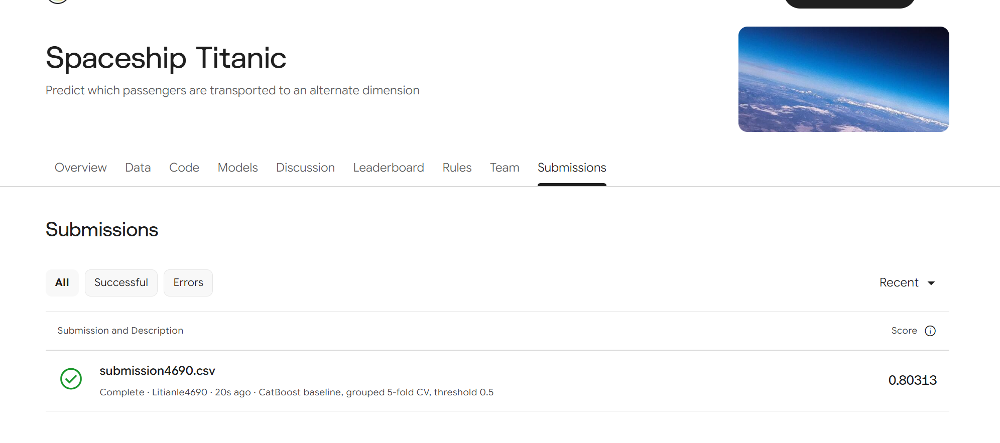
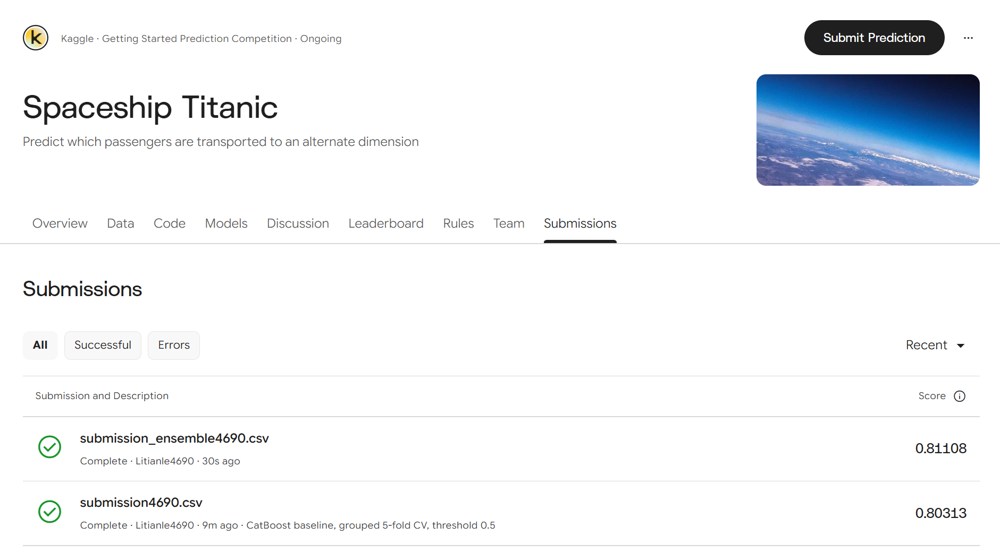
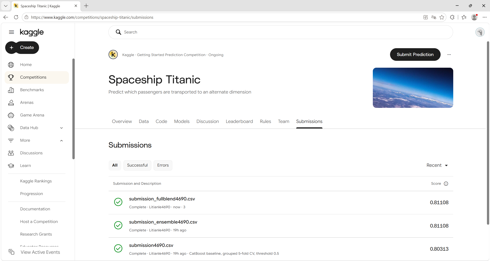

# Kaggle提交记录

比赛：Spaceship Titanic。更新日期：2026-10-29。

## 10月29日待试分候选 尚未提交

新增`outputs/kaggle_ready_4690/submission_regularized4690.csv`，采用原集成75%与G/E甲板局部LightGBM25%，阈值0.5。两次新分组五折的准确率分别由0.812148到0.814448、由0.814218到0.814794，净多预测正确20人和5人；10折中7折改善，Log loss均降低。该证据属于历史数据上的固定模型配对复验，不是新的盲测。

新文件与原集成有76个标签不同，4277行ID及顺序已验证；独立CLI重载模型生成的CSV逐字节一致。SHA256为`8715f16bb14eb6d5e4cdec84cd55b39ac1977208be71a1220833274b8a4d8ce9`。模型保存在`models/paired_regularization_20261029/ensemble.joblib`，29项测试通过。

**新候选尚无Kaggle成绩，当前最好仍为0.81108，继续保留原提交。** 配对同行组bootstrap的条件95%区间约为[-0.000908,+0.003633]，仍跨过0；它也没有计入训练与选择不确定性。上传时可填写描述：`75% frozen ensemble + 25% deck experts; grouped bagging; threshold 0.5`。完整实验见[学习与校准记录](学习与校准实验_20261029.md)。课程报告与源码包继续暂停整理。

## 已完成的平台提交

三份预测均已提交成功。CatBoost得分**0.80313**，冻结集成与全量重训融合均为**0.81108**。第三次没有提分，继续保留原45模型冻结集成为主方案。本地五折分数与平台评分分别记录。

| 模型 | 提交文件名 | 本地五折均值 | Kaggle得分 | 状态 |
|---|---|---:|---:|---|
| 原CatBoost | submission4690.csv | 0.8163 | 0.80313 | Complete，用户截图确认 |
| 冻结集成 | submission_ensemble4690.csv | 0.8157 | 0.81108 | Complete，当前平台最佳 |
| 全量重训与五折集成各50% | submission_fullblend4690.csv | 无新增OOF指标 | 0.81108 | Complete，与原集成持平 |

集成本地OOF包含参与过模型选择的折，属于选择后的描述性结果。此次本地五折与平台排序不同，保留原始本地结果。全量重训对照未产生新的OOF分数，不能借用原OOF。三次平台得分不足以证明跨数据集稳定提升，后续模型实验继续使用本地验证筛选。

## 首次提交证据

截图可见比赛名称、上传文件名、Complete状态、账号Litianle4690、模型描述和0.80313得分。未显示准确提交时刻和排名，因此记录中保持为空。模型关联依据提交描述及此前操作流程；截图不能验证上传文件的字节内容。

结构化记录：`reports/experiments/kaggle_submissions.json`。截图文件由用户原图直接复制，没有修改图片。

## 两次提交对照证据

该截图同时显示submission_ensemble4690.csv的0.81108分、submission4690.csv的0.80313分、两条Complete状态及账号信息，适合作为报告中的平台对照证据。截图中的相对时间不能确定准确提交时刻，记录中仍不填写时刻或排名。

## 当前候选与复现

### 第三次提交 2026-10-28

用户截图确认submission_fullblend4690.csv为Complete、得分0.81108，同时显示前两次成绩。该方案增加9个全量模型，与原45模型集成各50%，共54个模型；本地有34个测试标签变化，但显示分数持平，不能将变化解读为34处修正，也不能推断隐藏测试结果完全相同。继续保留原方案，避免在无观测收益时增加模型数量。

截图中的now和19h ago不作为精确提交时刻；成绩账本仅记录观察日期。原始图片直接复制保存，未修改像素。本阶段按用户要求暂停报告和源码包整理，现有本地DOCX/ZIP尚未同步第三次成绩。

当前平台最佳文件：`outputs/kaggle_ready_4690/submission_ensemble4690.csv`，原始候选位于`outputs/optimization_20261025/submission.csv`，完整模型位于`models/optimization_20261025/ensemble.joblib`。

准备文件与原CSV逐字节一致，SHA256为`270a687c3f9a942dfeedea8aef26af70bd24bb2bac14c3d50a249214c3681c82`，含4277名测试乘客。`manifest.json`保留两份CSV哈希及已观察到的成绩；本机outputs按.gitignore忽略。截图本身不能校验Kaggle服务器上文件的字节哈希。

同机隔离目录重训及模型重载已完成，提交CSV逐字节一致；检查见reports/checks/isolated_reproduction_20261028.json。此检查不冒充另一位成员或另一台机器的独立复现。完整进展见[后续训练与交付](后续训练与交付_20261028.md)。

## 课程报告所需材料

作业要求上传的CSV文件名带组长学号后四位；两份准备文件均使用4690。最终报告需要上传文件名与得分截图，以及小组信息截图。当前图片没有展示四人Team成员列表，还需另行保存小组信息。

作业中“组长提交即可，不要重复提交”针对雨课堂课程报告和成果物，由组长统一提交。两份作业文件没有规定Kaggle只能提交一次；实际日额度以比赛页面为准。
