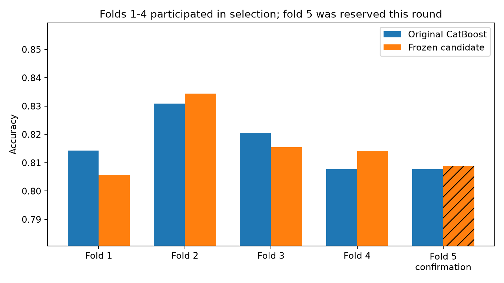

# 模型优化结果（2026-10-25）

**2026-10-28追加平台对照：全量重训融合submission_fullblend4690.csv得分0.81108，与原冻结集成持平。继续保留原45模型集成为主方案；第三次没有提分。** 该训练方式对照没有新的OOF分数，详见[Kaggle提交记录](Kaggle提交记录.md)。以下保留原始实验与前两次平台对照过程。

**2026-10-27平台验证更新：当前两次提交中以冻结集成得分最高，作为当前平台最佳候选。**

| 方案 | Kaggle得分 |
|---|---:|
| 原CatBoost | 0.80313 |
| 冻结集成 | 0.81108 |

集成相对基线的得分差为+0.00795，即+0.795个百分点。来源为用户提供的成功提交截图。
本地五折排序与这次平台排序不同；保留原始验证分数。两次平台结果不构成跨数据集稳定提升的证明。

完整截图与文件记录见[Kaggle提交记录](Kaggle提交记录.md)。以下保留原本地实验过程与判断依据。

**10月25日本地验证后的建议：保留原CatBoost为主力。新集成的最终五折均值略低，确认折仅小幅改善，作为独立榜分对照候选保留。**

实验：`optimization_20261025`；CatBoost参数试验32组，LightGBM参数试验48组。
原始数据、核心源码及依赖哈希见实验目录，运行方法见[模型优化与复现](成员1_模型优化与复现.md)。

## 冻结方案与确认

| 指标 | 准确率 |
|---|---|
| 本轮相同开发划分的固定CatBoost基线 | 0.811646 |
| 冻结方案开发集（第1～4折） | 0.821999 |
| 原CatBoost第5折 | 0.807825 |
| 冻结方案第5折 | 0.808976 |

本轮规则判断：**生成新候选**。阈值固定为0.5；融合权重和阈值均在第5折评估前保存。

第5折未参与本轮搜索或开发训练，但在旧基线中已经被查看，不能称为从未查看的盲测。开发分数来自较小训练分区，不能与原完整五折均值直接相减。

| 模型 | 特征 | 预处理 | 固定轮数 | 种子 | 权重 |
|---|---|---|---:|---|---:|
| catboost | spend | native | 555 | 42, 2026, 103 | 0.25 |
| catboost | rich_names | native | 748 | 42, 2026, 103 | 0.25 |
| lightgbm | base | rule_group | 327 | 42, 2026, 103 | 0.50 |

完整参数见frozen_plan.json。

## 最终重训与不确定性

冻结方案完成团队五折重训，共保存45个模型，测试概率按5个训练分区平均。最终OOF五折均值为0.815713 ± 0.011160，按样本加权准确率为0.815714。
原CatBoost同一团队五折均值为0.816287，新候选的描述性差值为-0.000574。
这些OOF分数包含参与过选择的第1～4折，只用于描述最终模型，不能当成新的无偏验证分数。

确认折修正旧模型32个错误，同时新增30个错误。按同行组配对bootstrap得到准确率差的95%区间为[-0.0070, +0.0101]。区间跨过0，目前证据不足以断言稳定优于原模型。

## 提交与复现产物

- 候选提交：`outputs/optimization_20261025/submission.csv`，4277行，PassengerId顺序与原test一致。
- 测试概率：`outputs/optimization_20261025/test_predictions.csv`。
- 完整模型：`models/optimization_20261025/ensemble.joblib`。
- 校验摘要：`reports/checks/optimization_20261025.json`；校验成功后才能确认保存模型的预测复现通过。

保存模型重算的训练准确率均值为0.869033，验证准确率均值为0.815713，差距为0.053320；逐折见training_gaps.csv。
此检查只描述冻结模型的拟合情况，没有据此修改模型或阈值。

## 诊断与边界

翻转全部训练标签后派生特征完全不变。3折分组LightGBM对抗验证中，基础、消费、姓名丰富方案AUC均约0.50；这是指定诊断器没有发现明显来源指纹，不能证明所有分布偏移都不存在。设置不同，不能与成员2旧AUC直接比较。
历史候选脚本已增加空列保护，防止把不存在的特征当作基线重复训练并覆盖旧结果。
本地模型实验阶段为2026-10-25；后续代码同步与平台提交进展见项目进度及Kaggle提交记录。

下一步：由另一位成员从原始数据复现，并将已取得的平台评分及模型对照写入课程报告。报告引用保留折与选择后OOF时注明不同含义。
