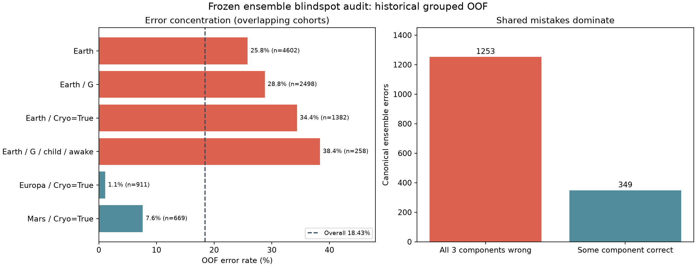

# 现有模型的薄弱点 2026-10-29

已逐折重载原45个模型，重现8693名训练乘客的折外预测，并核对另外两次分组五折。发现了错误集中的群体和具体表征缺口；尚未证明添加某个字段就能提分。本轮只做诊断，没有训练新模型或生成提交，Kaggle最好仍为0.81108。

## 主要问题集中在哪

原集成全五折OOF准确率为0.815714，错1602人。Earth乘客占4602/8693人，却贡献1188/1602个错误（74.2%）；Earth/G甲板占2498人，贡献719个错误（44.9%），错误率28.8%。后者在两次换分组中错误率约29.5%和29.7%，不像单次划分造成的孤立现象。

| 观察群体 | 训练人数 | 原OOF错误 | 错误率 | 测试特征中人数 |
|---|---:|---:|---:|---:|
| Earth | 4602 | 1188 | 25.8% | 2263 |
| Earth / G | 2498 | 719 | 28.8% | 1202 |
| Earth / Cryo=True | 1382 | 475 | 34.4% | 688 |
| Earth / G / child / awake | 258 | 99 | 38.4% | 124 |
| Europa / Cryo=True | 911 | 10 | 1.1% | 463 |
| Mars / Cryo=True | 669 | 51 | 7.6% | 365 |

群体相互重叠，人数和错误数不能相加。测试列只统计公开特征中的覆盖人数，不知道这些测试乘客是否预测错误。所有分数都是历史OOF描述，不能当作新盲测或Kaggle分数。

## 模型漏掉的是群体内部区分，而不只是整体概率

冷冻乘客在不同星球的结果差别很大：Earth实际传送比例65.63%，Europa为98.90%，Mars为91.18%。不能把“冷冻就几乎必传送”当作通用规则。

但原模型并没有完全漏学这一点：Earth冷冻乘客的平均预测概率65.98%，已经接近实际65.63%；其群体内部ROC AUC约0.674，说明更突出的是个体排序较弱。平均数接近不代表所有子群体都已校准，也不能证明不存在其他可学信号。

Earth冷冻乘客有91.3%被判为True，高于实际65.6%，这本身不构成预测错误的规则：若大部分个体概率都大于0.5，准确率最优的分类器可以把多数人判为True。强行把预测正例比例压到65.6%，可能反而降低准确率。

具体还应检查Earth/G甲板中未冷冻的儿童：258人错99人，错误率38.4%。他们的五项消费通常缺少区分度，需要更清楚地表达同行组内部的年龄和冷冻角色，而不只是再堆消费函数。

## 能明确核实的输入缺口

原集成50%权重的LightGBM基础方案，以及25%权重的消费CatBoost，都没有输入连续CabinNum、GroupIdNum及完整同行年龄/消费汇总；这些主要集中在另外25%的姓名丰富CatBoost中。原方案已有GroupSize、GroupPos、GroupSurnameCount，不能说完全没有同行信息。

三个候选表征在当前输入中没有直接出现：同组其他已知乘客的冷冻比例、同组其他成年人的平均年龄、同组其他儿童人数。本次只用公开无标签特征计算它们，并将自身值排除；描述性条件统计保存在mechanisms/candidate_context_descriptions.json。丰富方案已有GroupMeanAge、GroupMinAge、GroupMaxAge等相关信息，因此“字段名不存在”不等于“具有独立新信息”。

这提供了下一轮可检验的假设：在Earth/G及儿童群体中，明确编码同行角色、舱位分布与年龄的交互。需要在同折消融中验证增量，不能直接写成已经找到可提升成绩的特征。已有G/E局部模型、全局关系编码及物理消费特征的失败记录仍保留，不将这些旧方向改名宣称为新发现。

## 为什么单纯融合越来越难

1602个错误中，有1253个（78.2%）是三个成员类型共同犯的；只有349个错误存在某成员已经分对的情况。这349只是事后查看标签得到的可互补数量，不能把它当成可实现的提分上限或无泄漏的模型选择规则。

原始五折和两次换分组中都错的乘客有1364人，占原错误的85.1%；在三份预测中真实类别概率都不超过0.1的有74人。原OOF中有877个错误位于预测概率0.35至0.65之间，占错误的54.7%。大部分困难不能解释为少量极端离群点，但也不能据此断言这些错误不可约。

LightGBM三个种子的预测实际上相同，换种子没有增加这部分的模型多样性；这不改变其总权重，也不表示去重就会自动提分。

Mars/E甲板是一个可观察到的成员分工线索：330名训练乘客中，LightGBM在三种划分下都比姓名CatBoost更好。不过原五折若事后直接用LightGBM替代该群体的集成，也仅净多对3人，不能为此宣称全局稳定收益。条件融合的优先级低于寻找新判别信息。

## 已排除的简单解释

完整无缺失的6606人仍有18.07%错误；1项缺失为19.34%，2项及以上为21.36%。缺失样本稍难，但不能解释主要错误总量，也没有理由推翻此前“不在填补方法上过度投入”的结论。

舱号模2/3/4/5的探索未显示明显一致的交替规律；没有把偶然小分组差异当成新特征证据。对明显规律相反的74个高置信持久错误，已保存逐条清单，但没有外部证据证明标签有误，不改标签、不按验证答案制作规则。

## 证据与下一步

主要证据在reports/experiments/error_audit_20261029：slice_metrics.csv保留全部预定义群体；error_cases.csv保留1602个原OOF错误；confident_persistent_errors.csv保留74个高置信持久错误；feature_coverage.json保留实际模型输入。前12个高风险群体按GroupId做1000次条件bootstrap，但区间未经群体筛选或多重比较校正，不是因果或新增独立显著性证据。

下一轮应只测试少量同行角色和位置交互，优先观察Earth/G与儿童的错误是否下降、其余人群是否退化；保留同一分组基准和换分组复验，不根据测试集标签或榜分选择规则。当前只是明确了值得验证的薄弱环节，没有承诺突破0.82。

复现诊断需本机原模型和概率缓存：`python -m scripts.audit_model_blindspots`，再运行`python -m scripts.explain_model_blindspots`。该过程不拟合任何分类器。课程报告与源码ZIP继续暂停整理。
