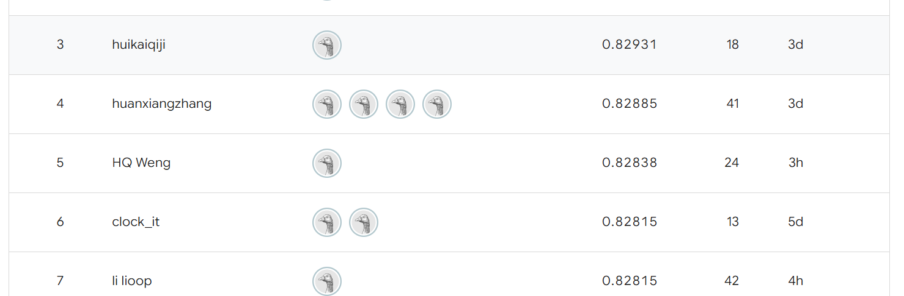

# 追赶前五与TabM对照（2026-10-31）

以用户提供的榜单截图为追赶基准：第五名HQ Weng显示0.82838，当前已确认最佳为0.81178，相差0.01660，即1.66个百分点。截图没有展示榜单完整范围，记录为该截图的第五名门槛，不推断全球名次。门槛可能继续变化，不能把它当作已达到或固定不变的成绩。



来源与数值见[目标快照](../reports/experiments/leaderboard_target_20261031.json)。本轮未执行Kaggle提交，平台最佳仍为昨日概率平均融合0.81178；课程报告和源码ZIP继续暂停。

## 新增模型对照

使用[作者TabM实现](https://github.com/yandex-research/tabm)，在既有隔离CUDA环境中增加`tabm==0.0.3`、`rtdl_num_embeddings==0.0.12`，原环境及历史冻结源码保持不变。TabM内部32个成员使用共享参数，训练优化各成员BCE的平均值，预测平均概率。采用作者默认宽度512、两层带数值嵌入的骨干，固定dropout=0.1、AdamW学习率0.002、weight decay=0.0003。

保持18列精简输入，7类类别特征与11项数值特征。消费取log1p，数值按训练数据中位数/IQR编码并截断到[-8,8]；常量及全缺失数值列不进入数值嵌入，未知类别使用保留索引。16个分位数区间和16维分段线性嵌入仅使用训练部分拟合。

每个外层训练折内，按完整GroupId再划出18%做停止轮数选择，最多200轮、耐心20轮。内部预处理只拟合内部训练行。选出轮数后，重新拟合整个外层训练集；外层验证标签不参与选轮数。外部固定使用当前最佳方案75%与TabM25%，阈值0.5，无参数、权重、阈值或输入搜索。

这次直接对照0.81178对应的方案：原树模型与8视图TabICL概率平均各50%。没有把更弱的原树方案单独当作晋级基线。

## 分组结果

先复用昨日两套划分，再使用未查看结果的新分组种子20261031、20261108。每阶段要求两次增益均非负、平均增益至少0.001、合计至少6/10折严格改善，且每次log loss退化不超过0.002；第一次整体负增益等条件触发时停止该阶段。假设与规则均在TabM比赛数据结果产生前冻结。

| 划分 | 当前方案准确率 | 加TabM后 | 净多对人数 | 改善折数/5 | 当前/新log loss |
|---|---:|---:|---:|---:|---:|
| 历史重复1 | 0.819395 | 0.819395 | 0 | 3 | 0.372659 / 0.370010 |
| 历史重复2 | 0.813413 | 0.815829 | +21 | 3 | 0.373597 / 0.372548 |
| 新分组1 | 0.812148 | 0.813873 | +15 | 3 | 0.375542 / 0.373252 |
| 新分组2 | 0.816519 | 0.816059 | -4 | 1 | 0.375258 / 0.372448 |

历史阶段通过；新分组平均增益约0.000633（0.0633个百分点），第二套退步，只有4/10折改善，**未通过晋级门槛**。按同行组对固定预测重采样的条件95%区间约[-0.001440, 0.002771]，包含零，且没有计入重训与选择不确定性。log loss改善没有稳定转化为本比赛的准确率增益。本轮没有生成新集成或提交CSV，也没有在失败后调整权重、阈值或改换划分。

完成20次TabM外层训练，每次包含内部轮数选择和外层全训练行重拟合；另外为新分组重训90个原方案树模型、10个8视图TabICL上下文，确保比较双方使用相同训练/验证划分。全部仍使用同一批已知历史乘客，新划分是敏感性证据，不是新的独立盲测。

冻结来源、逐折模型哈希、轮数和预测表见[实验目录](../reports/experiments/tabm_20261031/)。模型、缓存及CUDA环境留在被忽略的`models/`、`outputs/`中。

## 当前最佳仍漏掉什么

另外只读复查昨日当前最佳方案的两套分组预测，没有拟合模型或据此改变本轮配置。8693名乘客中，1397人两次都错，1795人至少一次错。以下每个群体在两次划分中使用相同乘客；重叠群体不能相加。

| 群体 | 人数 | 两次平均准确率 | 两次都错 |
|---|---:|---:|---:|
| Earth | 4602 | 0.74055 | 1036 |
| G甲板 | 2559 | 0.71063 | 613 |
| Earth/G甲板 | 2498 | 0.71177 | 596 |
| G甲板且CryoSleep=True | 1350 | 0.65481 | 374 |

G冷冻乘客平均预测概率0.6472，实际正类比例0.6593。平均比例接近，但个体区分仍弱，不能只凭整体正类比例接近就认为该群体已解决。记录见[误差诊断](../reports/experiments/incumbent_errors_20261031/summary.json)及[分群表](../reports/experiments/incumbent_errors_20261031/cohorts.csv)。

## 核验与下一步

58项测试通过，新增测试覆盖未知类别、缺失值、常量列、训练期统计固定、查询批次不改变输入及目标列拒绝。审计脚本独立重载模型，重算全部分组指标和门槛，核对内外层组隔离、内部停止轮数、训练期预处理及实际最新基线；详见[审计记录](../reports/checks/tabm_20261031.json)。训练与原始平台成绩账本均不修改。

训练采用固定TF32 `high`矩阵乘法设置。核验确认单行与批量查询的输入逐项相同，再用`highest`精度隔离GPU内核舍入影响；TF32单行/批量最大概率差约4.66e-5，`highest`下约5.96e-8。切换精度时，20折的TabM单模型预测合计有3个标签变化。晋级指标仍使用冻结训练设置的完整预测，没有利用精度切换选择结果；相同完整查询的模型重载误差为0。

```powershell
.\outputs\tabicl_env\Scripts\python.exe -m pip install --no-deps -r requirements-tabm.txt
.\outputs\tabicl_env\Scripts\python.exe -B -m scripts.tabm_study
.\.venv\Scripts\python.exe -B -m unittest discover -s tests -v
.\outputs\tabicl_env\Scripts\python.exe -B -m scripts.audit_tabm_study
.\.venv\Scripts\python.exe -B -m scripts.diagnose_current_incumbent
```

审计读取的完整测试日志为`outputs/tabm_20261031_tests.log`，运行完整测试时应将输出保存到该路径。完整实验依赖昨日已生成的参考分组、模型和预训练权重，不能跳过前轮训练。重复运行已完成实验只核对冻结协议并返回，不重新训练。协议以文件字节计算哈希；新增`.gitattributes`仅为本轮依赖的源码指定现有换行格式，避免Windows检出自动换行破坏来源校验，未改写历史源码。

下一轮优先检查TabICL视图数增加是否能减少分组波动，并继续寻找舱位位置对重复错误的区分信息；先固定方案再验证，避免重复挑选已有结果。本轮没有启动这两项后续实验。前五是追赶目标，当前证据尚不支持已能达到0.82838。
